# Phase 2 architecture — what changed and why

## Topology after Phase 2

<picture>
  <source media="(prefers-color-scheme: dark)" srcset="../diagrams/phase2/p2-topology-dark.svg">
  
</picture>

Dashed = added in Phase 2. Source: [`p2-topology.mmd`](../diagrams/phase2/src/p2-topology.mmd) · regenerate with `make p2-diagrams`

### Behaviour, step by step

| Extension | Sequence diagram |
|---|---|
| A — backup DNS failover | [light](../diagrams/phase2/p2-dns-failover-light.svg) · [dark](../diagrams/phase2/p2-dns-failover-dark.svg) · [source](../diagrams/phase2/src/p2-dns-failover.mmd) |
| B + E — TTL and DNS cutover | [light](../diagrams/phase2/p2-ttl-cutover-light.svg) · [dark](../diagrams/phase2/p2-ttl-cutover-dark.svg) · [source](../diagrams/phase2/src/p2-ttl-cutover.mmd) |
| D — HA failover at the edge | [light](../diagrams/phase2/p2-ha-failover-light.svg) · [dark](../diagrams/phase2/p2-ha-failover-dark.svg) · [source](../diagrams/phase2/src/p2-ha-failover.mmd) |

All four are also inlined in the Phase 2 section of [`docs/index.html`](../index.html#phase2).

## Changes from Phase 1

| Area | Phase 1 | Phase 2 | Cloud equivalent |
|---|---|---|---|
| DNS servers | one (Mac 1) | two, independent (Mac 1 + Mac 4) | Route 53's four name servers per zone |
| DNS TTL | 0 (no caching) | 30 s (caching observable) | record TTL chosen before a migration |
| Client resolvers | Mac 1 | Mac 1, then Mac 4 | VPC resolver + fallback |
| Backend reachability | anyone on the LAN | only the edges (pf `block drop`) | Security Group: inbound from the ALB SG only |
| Backend failure | passive `max_fails` | unchanged, plus a live health view | ALB target health checks |
| Edge ↔ backend keep-alive | nginx reuses idle sockets 60 s, Node closes them at 5 s | nginx drops them at **4 s**, Node keeps them **65 s** | ALB idle timeout shorter than the target's keep-alive |
| Edge | one (Mac 2) | primary + standby, chosen by DNS | multi-region ALB + Route 53 failover |

## Design decisions

**Backup DNS does not forward to the primary.** It serves the records itself.
A backup that depends on the primary fails together with it. The cost is
that a record change must be applied to both servers (`make p2-cutover` on
each). In production, zone transfers (AXFR/IXFR) keep secondaries in sync.

**pf `block drop`, not `block return`.** A dropped SYN times out (FILTERED).
A refused SYN gets a RST (CLOSED). Phase 1's wrong-port demo shows CLOSED, so
Phase 2's firewall shows a different, distinguishable failure. In Wireshark you
see repeated SYN retransmissions with no reply.

**pf rules live in an anchor, not in `/etc/pf.conf`.** macOS already evaluates
`anchor "com.apple/*"`. We load `com.apple/250.ParadiseIsolation` and enable pf
with a reference token (`pfctl -E`). Rollback flushes that one anchor and
releases that one token (`pfctl -X`). No system file is edited, and if pf was
already enabled for something else it stays enabled.

**Health checking stays passive in nginx.** Active `health_check` is an
nginx Plus feature. Open-source nginx detects failure from real traffic:
`max_fails=1 fail_timeout=10s` marks a dead server down, and
`proxy_next_upstream` retries the same request on the survivor, so clients see
zero errors. `make p2-health-watch` shows the backend state live without
sending traffic through nginx, because its own requests would disturb the
round-robin order seen by clients.

**The reusing side times out first (keep-alive ordering).** This was not in
the original design. We found it during an Ext D run. With Backend A stopped,
six requests got 502 even though Backend B was up. The edge error log showed
`upstream prematurely closed connection` on B: nginx (upstream
`keepalive_timeout` default 60 s) had sent a request down an idle socket that
Node (`server.keepAliveTimeout` default 5 s) was closing at that instant.
While both backends are up, that one failure is retried on the other backend
and nobody notices. With A dead, the retry had nowhere to go, and
`max_fails=1` then ejected B, the last healthy peer, for 10 s (`no live
upstreams`). The fix orders the two timers: nginx gives up on an idle socket at
**4 s**, and Node keeps it for **65 s** (`headersTimeout` 66 s, which must be
above `keepAliveTimeout`). These two lines are the only Phase 1 files Phase 2
edits, and `make p2-test` asserts exactly them. After the fix, the same demo ran
145 requests with 0 errors. AWS documents the same rule for ALB: the target's
keep-alive must be longer than the load balancer's idle timeout. Full write-up:
[report §3.2](report.md#32-real-incidents-found-while-running-the-demos).

**The standby edge reuses the certificate.** Clients connect by name, the
SAN covers it, and the CA is already trusted on every Mac. There is no new
trust to distribute.

## Remaining single point of failure

**The edge selection itself.** The standby removes Mac 2 as a *permanent* SPOF,
but failover is manual (`make p2-cutover`) and bounded by the TTL. Clients that
cached Mac 2 keep trying it for up to 30 s. To eliminate it, use one of:

1. **A floating virtual IP** (VRRP/keepalived, CARP). Both edges share one IP
   and the standby claims it within a second, with no DNS change and no TTL wait.
2. **DNS health-checked failover** (Route 53 failover records). The DNS server
   itself stops returning a dead edge. The TTL still bounds cutover time.
3. **An anycast or global load balancer** in front of both edges.

Backend A and B are no longer SPOFs (Ext D), and DNS is not either (Ext A).

## Shared fate on Mac 4

Mac 4 runs Backend B, the backup DNS **and** the standby edge. They use different
ports (`:3002`, `:53`, `:80/:443`), so they never clash. But they share one
machine: if Mac 4 itself dies, all three go together. The primary path
(Mac 1 DNS → Mac 2 edge → Backend A) still serves traffic, so no single machine
failure takes the service down. However, a Mac 1 failure *and* a Mac 4 failure
together would leave no DNS at all. A production design spreads the secondary
name server and the standby edge across separate failure domains (different
hosts, racks or availability zones). Here the placement keeps Mac 3 free of any
Phase 2 server, which makes it a clean client for the Ext A, B and E demos.
